# POS state diagrams

These diagrams describe **proposed** workflows using the [ERD](../erd.dbml).
They are proposed implementation contracts, not client-approved business policies or deployed application behavior.

Each diagram has a standalone Mermaid source file and a rendered Markdown block below.
The six enum-based lifecycles are stored. The other six diagrams describe derived conditions,
quantity flows or existing activation flags; they do not add unnecessary status columns.

## Rules shared by every workflow

- One transaction owns its source records, stock postings, reservation changes, state changes and audit evidence.
- Lock affected lots in a consistent order. Recheck usable quantity minus ACTIVE unreleased allocations before posting.
- Record actor, timestamp, reason where consequential, and from/to state. Retry the same logical request without another event or stock effect.
- Only listed transitions are valid; same-state edits require the workflow's edit rules. Terminal records remain historical.
- Preserve immutable applied prices, per-serving components, prepared quantities, posted movements and referenced recipes.
- Drafts, counts and recommendations do not post stock.
- Cancelled already-consumed stock is classified as waste without another negative movement.
- Expiry, role authority, yield basis and recovery safety need business-approved policies. The diagrams state conservative defaults.
- Foreign keys and row CHECK constraints are expressed in DBML. Cross-row sums, temporal transitions,
  permission checks, paired transfers, locking and append-only enforcement require later backend/database implementation.
- Forecasting, money workflows, full procurement, platform media/OCR, table splitting/transfers and station routing remain deferred.
- No independent state machines are needed for audit logs, stock movements, return rows or loss rows:
  they are immutable event records. Output QC and input settlement are derived from production/stock history.

## Diagram index

| Diagram | Representation |
| --- | --- |
| [Orders and kitchen](orders.mmd) | Stored `order_statuses` |
| [Production batches](production-batches.mmd) | Stored `production_statuses` |
| [Goods receipts](goods-receipts.mmd) | Stored `receipt_statuses` |
| [Physical counts](stock-counts.mmd) | Stored `count_statuses` |
| [Stock adjustments](stock-adjustments.mmd) | Stored `adjustment_statuses` |
| [Stock reservations](stock-reservations.mmd) | Stored `reservation_statuses` |
| [Order line preparation and cancellation](order-lines.mmd) | Derived; no extra status column |
| [Stock quantities and availability](stock-quantities.mmd) | Derived; no extra status column |
| [Production input settlement](production-inputs.mmd) | Derived; no extra status column |
| [Production output QC and disposition](production-outputs.mmd) | Derived; no extra status column |
| [Recipe version history](recipe-versions.mmd) | Derived; no extra status column |
| [User and catalog activation](catalog-activation.mmd) | Existing activation flags |

## Orders and kitchen

[Standalone Mermaid source](orders.mmd)

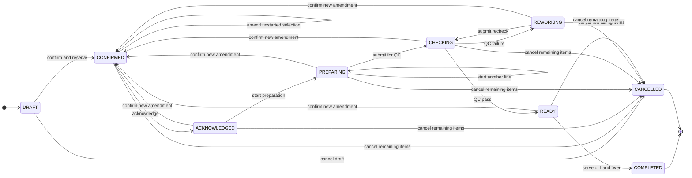

Source: PRD FR-005–010, §3.1, §6.3; Masterfile §3 and §5. One order owns its kitchen lifecycle.

| Transition | Guard and effect |
| --- | --- |
| DRAFT -> CONFIRMED | Validate brand/channel/allowed selections; snapshot applied components and prices; reserve all uncancelled servings atomically. |
| CONFIRMED -> ACKNOWLEDGED | Record acknowledgement actor/time. |
| ACKNOWLEDGED -> PREPARING | Start at least one line; snapshot prepared_quantity and consume its remaining allocations exactly once. |
| PREPARING or REWORKING -> CHECKING | All uncancelled lines have started; record QC submission. |
| CHECKING -> REWORKING | Record checker and QC failure reason. Additional physical consumption/waste is separately source-linked. |
| CHECKING -> READY | Successful recheck/pass for the current order revision; checker and ready time required. |
| READY -> COMPLETED | Serve/hand over all uncancelled selections; record completion; no new stock deduction. |
| Any open state -> CANCELLED | Cancel all remaining servings; release unused allocations, preserve consumption, and classify waste/recovery correctly. |
| Progressed open state -> CONFIRMED | A newly confirmed amendment invalidates previous READY/QC for the order revision; reserve only new selections. Previously prepared lines are never consumed again. |

COMPLETED and CANCELLED are terminal. Later administrative corrections append history and compensating stock records; they do not reopen these states.
Partial cancellation is a same-state amendment unless it cancels all remaining servings.
The ACKNOWLEDGED -> PREPARING step may start additional unstarted lines even when the parent is already PREPARING.
Only configured business permissions authorize transitions; the diagram does not approve a role matrix.

## Production batches

[Standalone Mermaid source](production-batches.mmd)

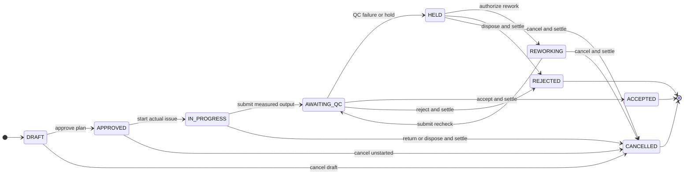

Source: PRD FR-018–023, §3.3, AC-04/15; Masterfile §2.

| Transition | Guard and effect |
| --- | --- |
| DRAFT -> APPROVED | Authorized reviewer; valid immutable production recipe/yield basis. Plan has no stock effect. |
| APPROVED -> IN_PROGRESS | Actual issue is recorded; transfer source quantities USABLE -> IN_PREPARATION. |
| IN_PROGRESS -> AWAITING_QC | Record measured outputs as HELD; normal use, returns and losses reconcile input issue. |
| AWAITING_QC -> HELD | Record QC failure/hold reason and checker; output stays unavailable. |
| HELD -> REWORKING -> AWAITING_QC | Authorized rework; additional inputs have separate issue rows; output/loss history is retained; recheck required. |
| AWAITING_QC -> ACCEPTED | Accept eligible output once; HELD -> USABLE; every issued input settled and every output accepted or disposed. |
| AWAITING_QC or HELD -> REJECTED | Record reason/actor; resolve issued inputs and dispose or explicitly recover all unusable output before terminal closure. |
| Open pre-QC/rework state -> CANCELLED | Record reason/actor; return safe unused inputs or dispose losses; no unsettled preparation stock or held output. |

ACCEPTED, REJECTED and CANCELLED are terminal. AWAITING_QC -> HELD -> CANCELLED is the cancellation route during QC.
Normal process consumption reduces IN_PREPARATION; it is distinct from a loss.
The primary expected output uses the recipe's declared output item/unit; secondary measured outputs are supported without inventing target yield factors.

## Goods receipts

[Standalone Mermaid source](goods-receipts.mmd)

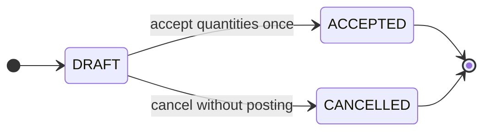

Source: PRD FR-013/017, §3.2, AC-03/12; Masterfile §1.

DRAFT records proposed inspection outcomes without posting stock. DRAFT -> ACCEPTED requires inspected lines, delivered = accepted + rejected, rejection reasons where needed, and authorized acceptance actor/time. Post only accepted quantities once. DRAFT -> CANCELLED records cancellation actor/time/reason and posts nothing.

ACCEPTED and CANCELLED are terminal. Correct an accepted receipt through an authorized source-linked compensating record; never edit the original receipt or convert ACCEPTED to CANCELLED.

## Physical counts

[Standalone Mermaid source](stock-counts.mmd)

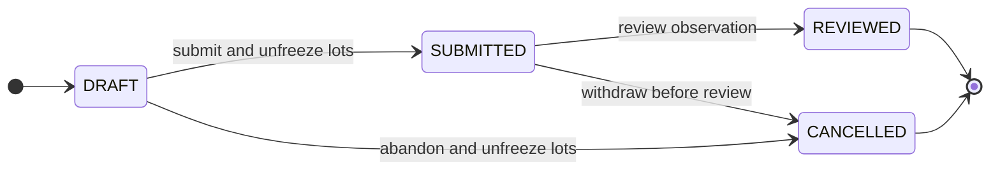

Source: PRD FR-014/015, AC-05/14, D-08.

DRAFT freezes the affected lots through active_stock_count_id before capturing expected quantities. Counted fields may remain null while observation is incomplete. DRAFT -> SUBMITTED requires every planned line's count, actor and timestamp; release count freezes in the same transaction.

SUBMITTED -> REVIEWED records the reviewer; it does not change stock. DRAFT -> CANCELLED abandons the count and releases every freeze. SUBMITTED -> CANCELLED withdraws an unreviewed observation.

REVIEWED and CANCELLED are terminal. A reviewed nonzero variance may produce one linked adjustment header, with each adjustment line linked uniquely to its exact count line. One count can contain multiple lot/bucket lines. A later count requires a new count record.

## Stock adjustments

[Standalone Mermaid source](stock-adjustments.mmd)

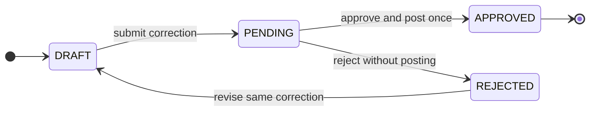

Source: PRD FR-015/016, AC-05/08/17.

DRAFT -> PENDING freezes the proposed lines for review. PENDING -> APPROVED requires authorized actor/time/reason and posts each delta exactly once atomically. PENDING -> REJECTED records review evidence without posting. REJECTED -> DRAFT revises the same correction, retaining previous review history; do not create another correction for the same count variance.

APPROVED is terminal. A later correction uses another compensating record and preserves the original.
For count-derived adjustments: stock_count_id is unique, each stock_count_item_id is unique, sources must agree on count/lot/bucket, and quantity_change equals counted_quantity - expected_quantity. The observation must be REVIEWED.
Reviewed count variance is a correction, never automatically a WASTE posting. Physical on-hand waste requires a verified cause.

## Stock reservations

[Standalone Mermaid source](stock-reservations.mmd)

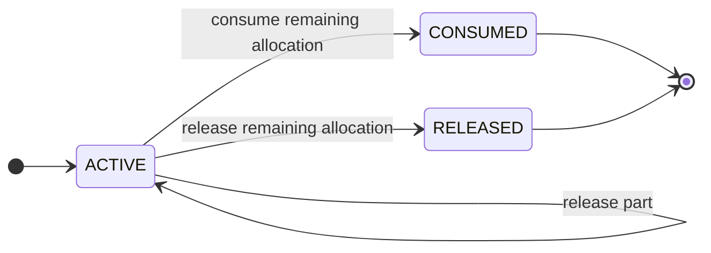

Source: PRD D-05, §6.3, FR-017/023.

Reservation quantity is the immutable original allocation. While ACTIVE, live quantity is quantity - released_quantity. Partial release increments released_quantity and keeps the row ACTIVE; full release sets released_quantity = quantity and transitions to RELEASED.

ACTIVE -> CONSUMED consumes only the unreleased quantity once and sets consumed_at. ACTIVE -> RELEASED sets released_at and posts no physical stock movement. A CONSUMED reservation may have a prior released_at if part was released before consumption.

CONSUMED and RELEASED are terminal. Recovery does not reactivate a reservation. Every allocation change locks its stock lot; the lot must match the component item. Allocation excludes expired, undated perishable, held and counted stock. Reserving does not change on-hand.

## Order line preparation and cancellation

[Standalone Mermaid source](order-lines.mmd)

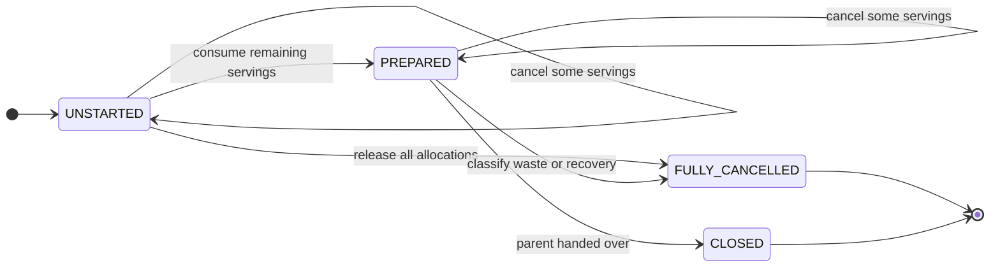

Derived lifecycle, not a new status column. Source: FR-008/023 and AC-09/18.

UNSTARTED means preparation_started_at is null and some servings remain. PREPARED means preparation_started_at and prepared_quantity are recorded and some servings remain. FULLY_CANCELLED means cancelled_quantity = quantity. CLOSED derives from parent COMPLETED.

Partial cancellation stays in UNSTARTED or PREPARED. Keep original quantity and per-serving component snapshots immutable. Before preparation, release per-serving quantity multiplied by cancelled servings. At start, prepared_quantity = quantity - cancelled_quantity. Later cancellation never changes prepared_quantity or removes consumption. A changed configuration gets a new line after cancelling the affected old servings. Parent QC/READY controls fulfillment; no per-item service state is added.

## Stock quantities and availability

[Standalone Mermaid source](stock-quantities.mmd)

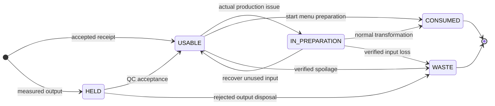

Quantity flow, not a single lot status. Source: FR-011/019–023 and AC-20.

A lot can hold USABLE, HELD and IN_PREPARATION quantities simultaneously. The diagram follows a quantity slice. Accepted receiving enters USABLE; measured production output enters HELD; QC acceptance transfers HELD to USABLE; issue transfers USABLE to IN_PREPARATION. Normal transformation consumes preparation quantity; returns transfer recoverable input back to USABLE; physical waste deducts its current bucket.

Reservation is an overlay on USABLE, not a fourth physical bucket. Expiry is calculated from use_by_at and requires_use_by, not a persisted EXPIRED status: expired quantities remain physically recorded until disposal. Unknown use-by for an item requiring it blocks allocation/usable acceptance until corrected by an authorized action. Disposal of expired stock is still allowed. Ledger/cache updates and paired transfers must be atomic.

## Production input settlement

[Standalone Mermaid source](production-inputs.mmd)

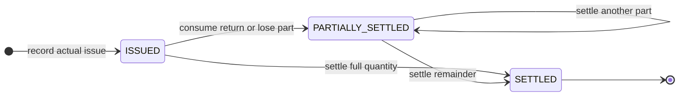

Derived lifecycle, not an additional enum. Source: FR-019/020 and AC-04/15.

ISSUED starts when an actual input row and its paired transfer commit. PARTIALLY_SETTLED means some input quantity has normal consumption, a return or a documented loss. SETTLED means issued_quantity equals normal consumption + returns + input losses, all in this source item's base unit.

Do not sum unrelated units. Bounds must prevent settling more than issued. Normal consumption is derived from source-linked PRODUCTION_CONSUMPTION movements. Terminal batch closure requires every input SETTLED. An issue already fully processed can move directly to SETTLED.

## Production output QC and disposition

[Standalone Mermaid source](production-outputs.mmd)

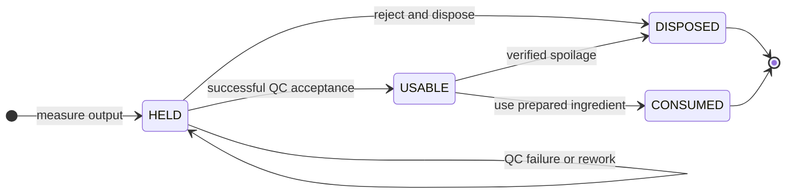

Derived quantity lifecycle, not a new output status. Source: FR-020/021 and AC-15.

The diagram follows one output quantity slice. Every measured output enters HELD and stays unavailable during QC failure/rework. QC acceptance moves its accepted portion to USABLE; the rest stays HELD or is disposed. Only an AWAITING_QC batch may accept output. Rework must re-enter AWAITING_QC before acceptance.

accepted_quantity is cumulative recorded acceptance, not current remaining stock. Later consumption/waste does not reduce historical accepted output. Terminal accepted batches have no unresolved held remainder; rejected/cancelled batches retain no usable output. Preserve measured output history; additional output and loss have separate records.

## Recipe version history

[Standalone Mermaid source](recipe-versions.mmd)

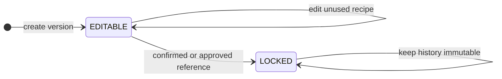

Derived lifecycle, not a stored status. Source: FR-004/023, PRD §6.4 and AC-18.

EDITABLE means no confirmed order or approved production batch references the version. The first qualifying reference makes the version LOCKED: its identity, instructions, yield basis and components cannot be rewritten. Corrections create a new version with the same code and a higher version.

Activation is independent: an inactive recipe stays available to historical references and may be reactivated under authorization. This does not unlock it. Recipe component quantities can reference raw or prepared inventory items. This diagram does not create an archive table or recipe inheritance framework.

## User and catalog activation

[Standalone Mermaid source](catalog-activation.mmd)

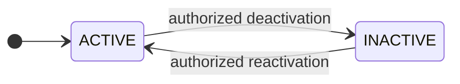

Stored boolean lifecycle shared by users, brands, menu items, modifiers, inventory items and recipes. Source: FR-001/029 and historical foreign-key integrity.

is_active=false prevents new authorized use according to the entity's purpose. It does not delete referenced operational history. Reactivation is authorized. Menu channel is_available is a separate flag: a globally inactive menu remains unsellable even if its channel flag is true. Deactivating an inventory item does not erase physical stock or remove the need to reconcile/dispose it. Deactivating a user prevents new actions; old actor references remain valid.
